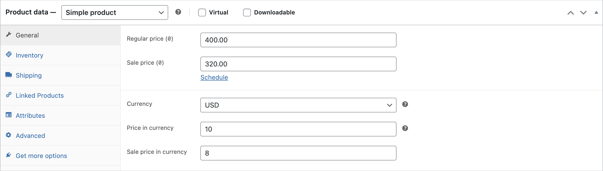
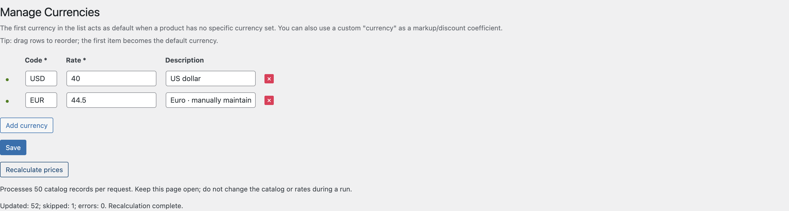

# TK Currency Manager for WooCommerce

**Maintain source-currency prices. Sell in your store's currency.**

A small WooCommerce plugin for catalogs whose prices are maintained in USD, EUR or another pricing unit. Define a conversion coefficient, enter each product's source price, and write the converted regular and sale prices through WooCommerce's product API.

For example, a UAH store with a `USD → 40` coefficient:

| Source price | Source sale price | Store regular price | Store sale price |
| --- | --- | --- | --- |
| 10 USD | 8 USD | 400 UAH | 320 UAH |

The same mechanism can represent a manually maintained markup coefficient. Rates are entered by a store manager; there is no external exchange-rate service.

## What it does

- Adds **WooCommerce → Currencies (TK)** with sortable currency codes, rates and descriptions.
- Adds source-currency fields to simple products and individual variations in the classic product editor.
- Recalculates managed prices on product/variation save, on demand in the admin, or with WP-CLI.
- Processes bulk admin runs in requests of **50 catalog records**, with updated/skipped/error counts and up to ten error details.
- Preserves the option and metadata keys used by the original theme implementation.

It stores normal WooCommerce prices. Catalogs, carts, discounts and checkout continue to use WooCommerce's pricing system. It does not add a customer-facing currency switcher or change the order currency.

## In the admin



<details>
<summary>Currency settings and a completed bulk run</summary>



</details>

Screenshots use an isolated demo store with synthetic products; coefficients are illustrative.

## Install

Requires WordPress 6.0+, PHP 7.4+ and an active WooCommerce installation. See [verification](#verification) for the combinations actually tested.

1. Clone this repository and run `bash bin/build.sh` to build an installable ZIP.
2. Upload the generated `dist/tk-currency-manager-0.2.0.zip` through **Plugins → Add New → Upload Plugin**, or copy the plugin into `wp-content/plugins/tk-currency-manager`.
3. Activate WooCommerce, then **TK Currency Manager for WooCommerce**.
4. Configure currencies before entering source prices.

Use a staging copy and back up the database before applying a new pricing rule to a live catalog. Recalculation writes product prices; it is not a preview.

## Set prices

1. Open **WooCommerce → Currencies (TK)**. Add a unique code and a positive rate: `store price = source price × rate`. Save the table.
2. Edit a simple product's **General** tab, or open a variation. Set **Currency**, **Price in currency**, and optionally **Sale price in currency**.
3. Save the product or variation. Changing a rate alone does not recalculate the catalog.
4. After a rate change, run **Recalculate prices** or:

   ```sh
   wp tk-currency recalc
   ```

| Input or situation | Result |
| --- | --- |
| Missing/empty source regular price | Skip; keep existing WooCommerce prices. Clear this field to opt out. |
| Source regular price `0` | Explicitly set a free product. |
| Empty source sale price on a managed product | Clear its WooCommerce sale price. |
| Empty currency selection | Use the first configured currency. Reordering changes this default. |
| Named currency removed or renamed | Report an error; preserve prices. Reassign affected products before recalculating. |
| `12.50` or `12,50` | Accept a decimal point or comma, with surrounding whitespace allowed. |
| Negative, malformed, scientific or grouped numbers | Reject; do not silently repair or partially save source fields. |
| Sale price at/above regular price after rounding | Reject; preserve prices. |
| Unmanaged variation | Skip independently; it does not inherit its parent's source fields. |

Prices round to the store's configured decimal places. Rates allow six decimal places and must remain positive after rounding. Existing WooCommerce sale dates are preserved; a future sale remains inactive until its scheduled start. When WooCommerce's scheduled-sale task ends a sale, its source sale field is cleared too, so the next recalculation cannot revive it. WordPress cron must be running for scheduled sales.

## Bulk runs and errors

Keep the admin page open until the completion message appears. The CLI processes the same batches without depending on a browser; it exits with an error status if any products failed.

Runs are **not transactional**: a request failure can leave earlier products updated. Fix the reported inputs and rerun; unchanged inputs produce the same prices. Avoid simultaneous runs, catalog deletions or rate edits during recalculation. Pagination uses ascending product IDs; concurrent catalog changes are not snapshot-isolated. Very large catalogs should use WP-CLI.

Simple products and variations are supported. Variable parent ranges are synchronized from their children. Grouped, external and custom product types are skipped. Integrations that import source metadata directly should call `tkcm_recalculate_product($id)` afterwards; ordinary REST/import saves do not automatically run the classic admin form handlers.

## Legacy compatibility and data retention

The data model intentionally retains these keys:

| Storage | Keys |
| --- | --- |
| Options | `teplo_klimat_currency_params`, `teplo_klimat_num_elements` |
| Product/variation metadata | `tk_currency`, `tk_curr_price`, `tk_curr_sale` |

Remove the old theme's pricing/save hooks when migrating; running two pricing implementations can produce conflicting writes. The legacy `woo_add_custom_general_fields` function suppresses duplicate simple-product fields, but is not a migration of the old save logic.

Deactivation and uninstall preserve currency settings, source metadata and the last converted WooCommerce prices. Shared legacy data is deliberately not deleted automatically. Delete it separately only after checking its consumers and making a backup.

The settings/bulk capability defaults to `manage_woocommerce` and can be changed with the `tkcm_manage_cap` filter. Product writes also require per-product edit permission and a valid form nonce. Bundled Ukrainian/Russian translations cover the original interface; newer validation/progress text falls back to English until translated.

## Verification

No WordPress installation or Composer dependency is needed for the fast checks:

```sh
bash bin/check.sh        # PHP lint, decimal/rate rules, dependency load order
node --check assets/admin.js
```

Run the real WordPress/WooCommerce suite with Docker and Compose v2:

```sh
bash bin/test-integration.sh
```

It creates an isolated store with synthetic products, downloads the pinned WordPress/WooCommerce versions, and removes its own containers and volumes on exit. It does not use DDEV or an existing store. Do not run `tests/integration.php` against a real shop.

Coverage includes unmanaged-price preservation, explicit zero, strict validation, sale clearing, scheduling and expiry, variation saves and parent price ranges, lookup tables, cart totals, multiple bulk pages, HTTP AJAX authorization/nonces, both plugin load orders, and uninstall retention. The fast checks also cover WooCommerce being absent.

The integration defaults are WordPress **7.1.3**, WooCommerce **11.2.1**, PHP **8.3**; override `TKCM_WP_VERSION` / `TKCM_WC_VERSION` to check another combination. These are reproducible test targets, not a recommendation to downgrade a store. PHP 7.4 is the syntax baseline; the tested matrix is recorded in [CHANGELOG.md](CHANGELOG.md).

## Development and packaging

- `tk-currency-manager.php` — bootstrap, settings page and product field rendering.
- `includes/pricing.php` — validation, conversion, persistence and batch results.
- `includes/product-admin.php` — protected product saves and AJAX endpoint.
- `tests/` — standalone probes and disposable-store integration suite.

`bash bin/build.sh` packages an explicit allowlist of runtime files and documentation into `dist/`. Tests, tooling, CI configuration and Git metadata are excluded.

This project began as an extraction of legacy theme pricing logic. Version 0.2.0 focuses on predictable validation, safe opt-in pricing and reproducible checks rather than additional pricing features.

[GPL-2.0-or-later](LICENSE).
